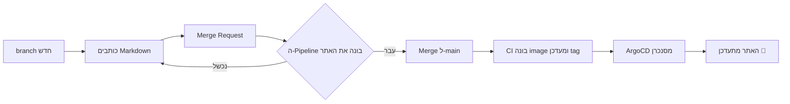

import Tabs from '@theme/Tabs';
import TabItem from '@theme/TabItem';

האתר בנוי ב-[Docusaurus](https://docusaurus.io). כל עמוד הוא קובץ Markdown בתיקייה `docs/`, והאתר נבנה ונפרס אוטומטית מ-Git.

## הדרך המהירה: לתת ל-Claude לעשות את זה {/* #claude */}

לא צריך להכיר Markdown או Docusaurus. פותחים [Claude Code](https://docs.claude.com/en/docs/claude-code) בתיקיית ה-repo ומביאים לו את החומר הגולמי, בכל פורמט ובכל שפה:

| איך | מה עושים |
|---|---|
| **להדביק** | מדביקים בצ'אט הערות, שרשור מ-Slack, לוגים, YAML או צילומי מסך, וכותבים `/add-docs` |
| **inbox** | זורקים קבצים לתיקייה `inbox/` (לא נכנסת ל-Git) ומריצים `/add-docs` |
| **ישר ב-repo** | שמים קובץ גולמי בתיקיית הפרק המתאים, למשל `docs/skills/notes.txt`, או כותבים טיוטה בתוך עמוד קיים, ומריצים `/add-docs` |

Claude ישאל שאלה אחת: האם זה פרק חדש, עמוד חדש בפרק קיים או תוספת לעמוד קיים. אחר כך הוא כותב את העמוד בעברית, מסדר קוד ותמונות, מסיר סודות, מריץ את הבדיקות ונותן קישור לתצוגה מקדימה. את ה-commit הוא מציע, לא עושה לבד.

:::tip[איך Claude יודע מה לעשות?]
הכללים כתובים ב-`CLAUDE.md` שבשורש ה-repo, ותהליך העבודה ב-`.claude/skills/add-docs/`. כשמשנים מוסכמה, מעדכנים שם.
:::

## תהליך העבודה



1. פותחים branch, כותבים ופותחים **Merge Request**.
2. ה-pipeline בונה את האתר. אם יש **קישור שבור** הבנייה נכשלת, וזה בכוונה.
3. אחרי merge ל-`main`, ה-CI בונה image, מעדכן את ה-tag ב-`deploy/helm/holmesgpt-docs/values.yaml`, ו-ArgoCD פורס. אין צורך לעשות שום דבר ידני.

:::tip[תיקון קטן?]
בתחתית כל עמוד יש קישור **"ערוך עמוד זה"**. הוא פותח את הקובץ ישירות לעריכה ב-GitLab.
:::

## הרצה מקומית

<Tabs groupId="runtime">
<TabItem value="make" label="make (מומלץ)" default>

```bash
make dev      # http://localhost:3000, live reload on save
make check    # fast checks: file names, frontmatter, images, secrets
make build    # full build, same as the pipeline
```

עובד עם Node מקומי, ואם אין npm אז דרך Docker. במצב Docker עוצרים עם `make stop`.

</TabItem>
<TabItem value="npm" label="npm">

```bash
cd site
npm ci
npm start
```

</TabItem>
</Tabs>

:::note[רשת סגורה]
אם npm לא מגיע לאינטרנט, מגדירים פעם אחת את ה-registry הפנימי:
`npm config set registry https://nexus.example.internal/repository/npm/`
:::

## מבנה התיקיות

כל התוכן נמצא בתיקייה `docs/`. כל פרק הוא תיקייה, וכל עמוד הוא קובץ. התבניות ב-`docs/_templates/` לא מוצגות באתר.

```text
docs/                        ← all content lives here
├── intro.mdx                ← the /docs welcome page
├── _templates/              ← page templates (not published)
├── architecture/            ← a section = a folder
│   ├── _category_.json      ← section name and sidebar position
│   ├── index.mdx            ← section landing page
│   ├── overview.md          ← a regular page
│   ├── img/                 ← section images
│   └── files/               ← downloadable files (dashboard JSON etc.)
├── opening/ · skills/ · dashboards/ · deployment/ · operations/ · benchmarks/ · unit-8200/ · upgrades/ · team/
└── contributing/            ← this page
inbox/                       ← raw material for Claude (not in git)
site/                        ← the site engine (design and homepage cards only)
deploy/                      ← Docker, Helm, ArgoCD
```

## הוספת עמוד

1. מעתיקים תבנית מ-`docs/_templates/` לתיקיית הפרק המתאים, למשל `docs/upgrades/tool-calling-fix.md`.
2. ממלאים את ה-frontmatter שבראש הקובץ:

```md title="docs/upgrades/tool-calling-fix.md"
---
title: תיקון ל-Tool Calling
sidebar_position: 2      # order within the section (lower = higher up)
description: משפט אחד שמסביר על מה העמוד.
---
```

3. כותבים. העמוד מופיע אוטומטית בסיידבר ובכרטיסים של עמוד הפתיחה של הפרק.

**שם הקובץ קובע את ה-URL**, לכן כדאי לתת שמות באנגלית ובאותיות קטנות עם מקפים (`tool-calling-fix.md` ולא `תיקון 1.md`).

## הוספת פרק חדש

1. יוצרים תיקייה חדשה תחת `docs/`, למשל `docs/security/`.
2. מעתיקים אליה את `_category_.json` ואת `index.mdx` מפרק קיים ומעדכנים את השם, התיאור וה-`position`.
3. (מומלץ) מוסיפים כרטיס לעמוד הבית ב-`site/src/data/sections.tsx`.

תת-פרק עובד בדיוק אותו דבר: תיקייה בתוך תיקייה.

## ארגז כלים

### קישורים בין עמודים

משתמשים בנתיב **יחסי לקובץ** כולל הסיומת. כך הבנייה מוודאת שהקישור לא שבור:

```md
ראו [הפריסה](../deployment/index.mdx) ואת [ה-patch הזה](./tool-calling-fix.md#rollback).
```

### תמונות

שומרים בתיקיית `img/` של הפרק ומפנים בנתיב יחסי: ``

### הערות מודגשות

```md
:::tip[טיפ]
:::

:::info[מידע]
:::

:::warning[זהירות]
:::

:::danger[סכנה]
:::
```

:::warning[זה נראה ככה]
אפשר גם לתת כותרת משלכם.
:::

### בלוקי קוד

מוסיפים שפה, כותרת (`title`) והדגשת שורות (`{2-3}`):

````md
```yaml title="values.yaml" {2-3}
holmes:
  model: gpt-4o
  toolsets: [kubernetes]
```
````

### דיאגרמות (Mermaid)

כותבים בלוק קוד בשפה `mermaid` והוא מוצג כדיאגרמה, כמו התרשים בראש העמוד. [תיעוד Mermaid](https://mermaid.js.org/intro/).

### תוכן מתקפל

```md
<details>
<summary>לחצו לפרטים</summary>

תוכן ארוך שלא כולם צריכים.

</details>
```

## טיפים לכתיבה בעברית

- **מונחים טכניים באנגלית** (Pod, patch, toolset) כותבים כמו שהם. שמות קבצים, פקודות וערכים עוטפים ב-`backticks`.
- **משפט שמתחיל במילה באנגלית** עלול להשתבש בכיוון. עדיף לפתוח במילה בעברית: "ה-Deployment של Holmes..." ולא "Deployment של Holmes...".
- **כותבים בשביל מי שיגיע אחרינו.** מסבירים *למה* ולא רק *מה*: למה עשינו את ה-patch, איזו בעיה ה-skill פותר.

## לפני שפותחים MR

- [ ] `make check` ו-`make build` עוברים מקומית
- [ ] יש ב-frontmatter את `title` ואת `description`
- [ ] תמונות נמצאות בתיקיית `img/` של הפרק, בלי סודות, טוקנים או כתובות IP רגישות
