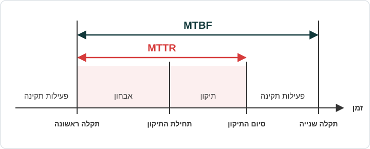

import SectionPages from '@site/src/components/SectionPages';

את פרויקט HolmesGPT התחלנו בסביבות פברואר 2026, בתחילת "עם כלביא".

את HolmesGPT מצא שמעוני. הוא ראה שזה מוצר של ה-CNCF, ושהוא עונה, בגדול, על כל מה שרצינו להשיג. אנחנו אוהבים CNCF, אז התלהבנו והתחלנו בתהליך ההטמעה.

כמובן שקודם כול היה צריך להתעסק במשאבי GPU, אבל על כך נדבר בהמשך.

מטרת העל של הפרויקט הייתה לקצר את ה-MTTR של המשמרת.

### מה זה MTTR?

ה-MTTR, קיצור של **Mean Time to Repair**, הוא משך הזמן מהרגע שבו מתגלה תקלה ועד הרגע שבו היא נפתרת.

כפי שרואים בתרשים, ה-MTTR כולל שני שלבים: אבחון התקלה ותיקונה.

## על התיעוד הזה

בתיעוד הזה אפרט על HolmesGPT. אציג את המערכת ברמת ה-High Level, וארד גם לרזולוציות הנמוכות ביותר. כל זאת כדי לשמר את הידע על המערכת, כך שהצוות יוכל לתחזק אותה עוד שנים רבות.

באופן כללי, לפני שצוללים לפרויקט, אני יוצא מנקודת הנחה שיש לכם ידע בסיסי ב-AI ואיך Agentים עובדים. במידה ולא (וזה לגיטימי לגמרי, העיסוק הזה חדש לכולנו), אני ממליץ לכם בחום להיכנס קצת לעולם המושגים ולהבין מעט את השפה. זה מאוד יעזור לכם להיכנס לפרויקט, וגם באופן כללי, זה חומר שחשוב לדעת.

אני ממליץ המלצה רותחת לראות ביוטיוב את הסרטון של Andrej Karpathy (הלוא הוא לברון ג'יימס של ה-AI) שנקרא "Deep Dive Into LLMs Like ChatGPT". הוא אמנם מעט ישן, אך הוא מקנה ידע בסיסי **מדהים** בנוגע לאיך מודל עובד.

מקווה שתמצאו בתיעוד הזה ערך. קריאה מהנה!

<SectionPages />
